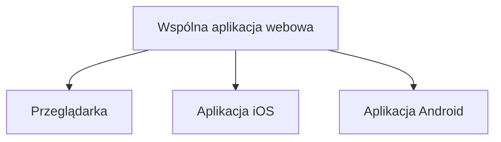

<div align="center">

<table><tr><td align="center" valign="middle"></td><td align="center" valign="middle"></td></tr></table>

### Plan zajęć, orientacja na kampusie i społeczność akademicka — w jednym miejscu.

**Wiesz, gdzie masz być. I z kim.**

</div>

**Status projektu:** etap koncepcyjny / planowanie MVP  
**Platformy docelowe:** przeglądarka internetowa, iOS, Android  
**Model produktu:** jedna responsywna aplikacja webowa, dostępna również przez aplikacje mobilne  
**Odbiorcy:** studenci, w szczególności osoby rozpoczynające studia  
**Identyfikacja wizualna:** wersja 1.0 · październik 2026

> [!IMPORTANT]
> README przedstawia założenia i plan rozwoju StudyPlaner, a nie listę ukończonych funkcji. Księga identyfikacji opisuje strategię marki i koncepcyjne przykłady ekranów. Nie potwierdza istnienia gotowej aplikacji, integracji z uczelniami ani dostępu do oficjalnych danych.

---

## Spis treści

- [O projekcie](#o-projekcie)
- [Problem, który rozwiązujemy](#problem-który-rozwiązujemy)
- [Dla kogo powstaje StudyPlaner](#dla-kogo-powstaje-studyplaner)
- [Planowane funkcjonalności](#planowane-funkcjonalności)
- [Przykładowy scenariusz](#przykładowy-scenariusz)
- [Platformy i założenia techniczne](#platformy-i-założenia-techniczne)
- [Zakres MVP](#zakres-mvp)
- [Identyfikacja wizualna](#identyfikacja-wizualna)
- [Zasady projektowania interfejsu](#zasady-projektowania-interfejsu)
- [Dane, wiarygodność i prywatność](#dane-wiarygodność-i-prywatność)
- [Plan rozwoju](#plan-rozwoju)
- [Organizacja pracy](#organizacja-pracy)
- [Uruchomienie projektu](#uruchomienie-projektu)
- [Dokumentacja](#dokumentacja)
- [Współpraca i zgłaszanie problemów](#współpraca-i-zgłaszanie-problemów)
- [Licencja i zastrzeżenia](#licencja-i-zastrzeżenia)

---

## O projekcie

**StudyPlaner** to koncepcja wieloplatformowego narzędzia wspierającego codzienne życie studenckie. Jego celem jest zebranie w jednym, czytelnym środowisku informacji o **zajęciach, ich zmianach, lokalizacji sal, kontaktach akademickich i aktywnościach społeczności**.

Projekt nie ma być kolejnym rozbudowanym systemem administracyjnym uczelni ani zwykłą listą zadań. Jego zadaniem jest pomóc szybko odpowiedzieć na trzy pytania:

1. **Co i kiedy?** — jakie zajęcia lub wydarzenia mam dziś w planie?
2. **Gdzie?** — w którym budynku i sali powinienem być, jak tam trafić?
3. **Z kim?** — z kim mogę się skontaktować, uczyć lub zaangażować w życie uczelni?

Ideą produktu jest połączenie **czasu, miejsca i ludzi**. Tę samą myśl odzwierciedla identyfikacja wizualna marki: ścieżka symbolizuje drogę przez dzień akademicki, a punkt oznacza miejsce i moment „tu i teraz”.

## Problem, który rozwiązujemy

Na początku studiów potrzebne informacje bywają rozproszone między systemami uczelnianymi, planem zajęć, ogłoszeniami i grupami na komunikatorach. Student musi je samodzielnie wyszukać, porównać i ocenić ich aktualność.

StudyPlaner ma ograniczyć to rozproszenie poprzez:

- szybki dostęp do dzisiejszego planu i czytelne wyróżnienie najbliższych zajęć;
- jasne wskazywanie budynku, piętra i numeru sali;
- informowanie o zmianach wraz ze źródłem i czasem aktualizacji;
- ułatwienie odnalezienia osób, grup i wydarzeń związanych z uczelnią;
- uporządkowaną, rzeczową komunikację bez nadmiaru nieistotnych powiadomień.

**Najważniejsza zasada:** najpierw rzetelna informacja, dopiero później dodatkowe funkcje. Nieaktualny plan podważa zaufanie do całego produktu.

## Dla kogo powstaje StudyPlaner

| Grupa | Główna potrzeba | Priorytet |
| --- | --- | --- |
| **Studenci pierwszego roku** | Orientacja w planie, kampusie i społeczności | Główna grupa docelowa |
| Studenci starszych lat | Zmiany zajęć, wydarzenia, terminy i kontakt | Rozszerzenie zastosowań |
| Wykładowcy | Czytelny i przewidywalny kanał przekazywania informacji | Rola wymagająca potwierdzenia |
| Uczelnie i samorządy | Udostępnianie aktualnych informacji studentom | Potencjalni partnerzy; brak potwierdzonych integracji |

Segmenty i potrzeby opisane w księdze identyfikacji są w dużej mierze **hipotezami projektowymi**, które wymagają rozmów i testów z odbiorcami.

## Planowane funkcjonalności

### 1. Plan zajęć

Centralny widok dnia i tygodnia, przygotowany do wygodnego użycia również na telefonie.

- zajęcia uporządkowane chronologicznie;
- godzina rozpoczęcia i zakończenia, nazwa przedmiotu oraz rodzaj zajęć;
- budynek, piętro, numer sali i prowadzący, o ile dane są dostępne;
- wyróżnienie aktualnie trwających lub najbliższych zajęć;
- informacja o zmianie sali lub odwołaniu zajęć;
- widoczne źródło i czas ostatniej aktualizacji danych.

### 2. Mapa kampusu i nawigacja

Funkcja pomagająca przejść od informacji „mam zajęcia w sali 0.08” do informacji „wiem, jak tam dotrzeć”.

- wyszukiwanie budynków i sal;
- podgląd lokalizacji oraz wskazówki dotarcia;
- opisy wejść, pięter i korytarzy, gdy takie dane zostaną przygotowane;
- przejście z wydarzenia w planie do informacji o lokalizacji.

**Uwaga:** dokładna nawigacja wewnątrz budynków i czasy przejścia zależą od dostępności zweryfikowanych danych o kampusie. Przykładowe trasy w księdze znaku nie są działającą funkcją.

### 3. Ludzie i społeczność

Przestrzeń pozwalająca odkrywać aktywności akademickie bez presji uczestniczenia.

- informacje o grupach studenckich i kołach naukowych;
- odnajdywanie wydarzeń i inicjatyw na uczelni;
- możliwość nawiązywania kontaktów związanych z kierunkiem lub rokiem;
- dobrowolne uczestnictwo w aktywnościach i kontrola udostępnianych informacji.

### 4. Wiadomości i komunikacja

Docelowo StudyPlaner ma ułatwiać wymianę informacji związanych ze studiami.

- uporządkowane wiadomości i komunikaty;
- jasne odróżnienie informacji oficjalnych od treści dodanych przez użytkowników;
- kontekst wiadomości, np. przedmiot, grupa lub wydarzenie;
- możliwość kontaktu z prowadzącymi **wyłącznie po uzgodnieniu odpowiedniego modelu współpracy**.

### 5. Powiadomienia o istotnych zmianach

Przewidywany kierunek rozwoju obejmuje powiadomienia dotyczące ważnych zdarzeń, np. zmiany sali, odwołania zajęć czy aktualizacji wydarzenia. Powiadomienia powinny być **istotne, możliwe do skonfigurowania i oparte na wiarygodnych danych**.

## Przykładowy scenariusz

> **9:45 — rozpoczynają się laboratoria.**
>
> Student otwiera StudyPlaner, widzi najbliższe zajęcia, a przy nich zmianę sali z `2.14` na `0.08`. Aplikacja pokazuje budynek i piętro oraz — jeśli dane nawigacyjne są dostępne — sposób dotarcia na miejsce. Po zajęciach student sprawdza, czy jego koło naukowe organizuje spotkanie.

To **scenariusz docelowego doświadczenia użytkownika**, nie demonstracja już zaimplementowanego przepływu.

## Platformy i założenia techniczne

Zamiast rozwijać trzy niezależne produkty, projekt zakłada **jedną aplikację webową** obsługującą interfejs i logikę prezentacji, dostępną na trzech platformach:

| Platforma | Zakładany sposób dostępu |
| --- | --- |
| **Web** | Responsywna aplikacja uruchamiana w przeglądarce |
| **iOS** | Aplikacja mobilna korzystająca ze wspólnej aplikacji webowej |
| **Android** | Aplikacja mobilna korzystająca ze wspólnej aplikacji webowej |



Takie podejście ma ułatwić utrzymanie wspólnego interfejsu, spójnych funkcji i jednolitych zasad projektowych. **Wybór frameworka, zaplecza serwerowego, bazy danych, metody uwierzytelniania oraz technologii opakowania na iOS/Android pozostaje do ustalenia.**

Integracje z systemami uczelni nie są założone jako istniejące. Ich wykonanie wymaga dostępu do odpowiednich źródeł danych, określenia uprawnień i uzgodnień z właścicielami systemów.

## Zakres MVP

MVP (*Minimum Viable Product*) to pierwsza możliwa do przetestowania wersja produktu. Poniższy podział jest **propozycją organizacji prac**, a nie listą zakończonych zadań.

| Zakres | Proponowany etap |
| --- | --- |
| Responsywny szkielet aplikacji i nawigacja między widokami | MVP |
| Widok planu dnia i podstawowe szczegóły zajęć | MVP |
| Oznaczanie zmian oraz źródła informacji | MVP |
| Podstawowy katalog budynków i sal | MVP |
| Widok wydarzeń i grup studenckich | MVP / jeśli pozwoli czas |
| Pełna nawigacja wewnątrz budynków | Dalszy rozwój |
| Integracje z uczelnianymi źródłami planu | Po weryfikacji dostępu |
| Kanał komunikacji z wykładowcami | Po uzgodnieniach |
| Zaawansowane powiadomienia i personalizacja | Dalszy rozwój |

W pierwszym etapie można korzystać z **jawnie oznaczonych danych demonstracyjnych**. Nie wolno przedstawiać ich jako rzeczywistych ani aktualnych danych uczelni.

## Identyfikacja wizualna

Identyfikacja StudyPlaner opiera się na kierunku **„Ścieżka i punkt”**. Charakter marki ma być uporządkowany, nowoczesny, czytelny i spokojny — bez estetyki urzędowego systemu ani dziecięcego planu lekcji.

### Logo

Podstawowy znak łączy:

- **sygnet** — geometryczną literę **S** przypominającą trasę;
- **punkt** — symbol „tu jesteś / teraz”;
- **logotyp** — zapis `StudyPlaner` w kroju Inter Display Bold, przygotowany jako krzywe w oryginalnych plikach wektorowych.

Przewidziano odmiany poziomą, pionową, sam sygnet oraz warianty kolorowe, negatywowe i monochromatyczne. Oryginalnych znaków nie należy rekonstruować zwykłym tekstem ani modyfikować ich proporcji.

**Ikona aplikacji:** biały sygnet na pełnym tle `#0033A0`. Zaokrąglenie ikony powinno wynikać z maski systemu iOS lub Android.

> Pliki logo, ikon i tokenów CSS zostały wymienione w księdze identyfikacji wizualnej. Nie są automatycznie częścią tego repozytorium — należy dodać oryginalne pliki do projektu, gdy będą dostępne.

### Paleta kolorów

| Rola | Kolor | HEX |
| --- | --- | --- |
| Kolor podstawowy / tekst jasnego motywu | Czerń | `#0A0A0B` |
| Kolor podstawowy / tekst ciemnego motywu | Biel | `#FFFFFF` |
| Akcent na jasnym tle | Granat | `#0033A0` |
| Akcent na ciemnym tle | Jasny granat | `#6B8FE8` |
| Ciemne powierzchnie | Grafit | `#1B1C20` |
| Tekst drugorzędny na jasnym tle | Szary 600 | `#5A5F6B` |
| Tekst drugorzędny na ciemnym tle | Szary 400 | `#9A9FAA` |
| Linie i podziały | Szary 200 | `#E3E5EA` |
| Jasne tła sekcji | Szary 50 | `#F4F5F7` |
| Delikatne wyróżnienie | Granat 10 | `#E6ECF7` |
| Zmiana / odwołanie | Czerwony | `#C42B1C` |
| Ostrzeżenie | Bursztynowy | `#A65800` |
| Potwierdzenie | Zielony | `#1E7F45` |

Granat jest **akcentem**, a nie dominującym tłem standardowego interfejsu. Powinien wskazywać bieżący element albo główne działanie. Wyjątkiem jest m.in. ikona aplikacji.

W ciemnym motywie stosujemy `#6B8FE8` zamiast `#0033A0` dla akcentów na czarnym i grafitowym tle. Według księgi identyfikacji kontrast `#0033A0` na `#0A0A0B` wynosi tylko **1,87:1**, dlatego to połączenie nie jest odpowiednie dla treści.

### Typografia

- **Inter Display** — nagłówki i elementy o wysokiej randze wizualnej.
- **Inter** — tekst, przyciski, etykiety i pozostałe elementy interfejsu.
- **Cyfry tabelaryczne (`tnum`)** — godziny i numery, które powinny układać się równo w kolumnach.
- **Inter SemiBold** — nazwy bieżących zajęć, etykiety i wybrane elementy nawigacyjne.

Krój Inter jest udostępniany na licencji SIL Open Font License 1.1; dołączając pliki fontów do projektu, należy zachować właściwą informację licencyjną.

### Zasady stosowania marki

- Nie rozciągamy, nie obracamy i nie zmieniamy konstrukcji logo.
- Nie dodajemy cieni, gradientów, efektów 3D ani nowych kolorów kropki.
- Dbamy o pole ochronne oraz minimalne rozmiary znaku.
- Na granatowym tle wykorzystujemy białą wersję monochromatyczną.
- Kolory czerwony, bursztynowy i zielony mają **znaczenie funkcjonalne**, a nie dekoracyjne.
- Nie używamy koloru jako jedynego sposobu przekazania statusu — dodajemy tekst lub ikonę.

Pełne parametry konstrukcji znaku, zastosowania na tłach i wymagania produkcyjne zawiera księga identyfikacji wizualnej.

## Zasady projektowania interfejsu

### Informacja w ustalonej kolejności

Najważniejsze dane prezentujemy konsekwentnie:

1. **Co?** — przedmiot lub wydarzenie.
2. **Kiedy?** — data i godzina.
3. **Gdzie?** — budynek, piętro i sala.
4. **Kto / jaka zmiana?** — prowadzący, uczestnicy, status.

### Mobilność i czytelność

Projekt powinien nadawać się do użycia w ruchu i jedną ręką. Z księgi identyfikacji wynikają m.in.:

- siatka mobilna oparta na **4 kolumnach**;
- marginesy boczne **16 px** i odstęp między kolumnami **12 px**;
- skala odstępów: **4, 8, 12, 16, 24, 32, 48 i 64 px**;
- bazowy rytm **8 px**, z podziałkami 4 px dla drobnych elementów;
- „sloty” informacyjne w formie zaokrąglonych prostokątów o promieniu **12 px**;
- czytelny kontrast, hierarchia typograficzna i brak zbędnych ozdobników.

### Ton komunikacji

Komunikaty systemowe powinny być **klarowne, rzetelne, życzliwe i nienachalne**.

**Tak:**

> Zmiana sali: Programowanie I → 0.08, parter.  
> Informacja od prowadzącego, 7:42.

**Nie:**

> Uwaga!!! Superważna wiadomość!!! 😱

Używamy określenia **„plan zajęć”**, a nie „plan lekcji”. Nie stosujemy presji społecznościowej, przesadnego entuzjazmu ani nieuzasadnionych zapewnień o aktualności informacji.

## Dane, wiarygodność i prywatność

Zaufanie do informacji jest podstawą projektu. Dlatego docelowe rozwiązanie powinno uwzględniać:

- oznaczenie **źródła i czasu aktualizacji** każdej istotnej zmiany;
- rozróżnienie informacji oficjalnych, użytkowników i danych demonstracyjnych;
- ostrożne używanie powiadomień — tylko w kontekście spraw istotnych dla odbiorcy;
- minimalizację danych osobowych i przejrzyste ustawienia prywatności;
- możliwość korzystania z informacji o kampusie bez wymuszania publicznego udostępniania lokalizacji;
- właściwe uprawnienia i zasady dostępu do wiadomości oraz danych konta;
- weryfikację zgodności przetwarzania danych z obowiązującymi przepisami, w tym RODO, **przed uruchomieniem produkcyjnym**.

**StudyPlaner nie deklaruje na tym etapie partnerstwa z żadną uczelnią ani dostępu do jej oficjalnych systemów.** Nie należy przedstawiać informacji jako pochodzących z oficjalnego kanału bez odpowiedniego potwierdzenia.

## Plan rozwoju

Poniższe etapy opisują **proponowany plan prac na jeden semestr projektu zespołowego**.

| Etap | Główne prace | Rezultat |
| --- | --- | --- |
| **1. Analiza** | Doprecyzowanie przypadków użycia, zakresu MVP i źródeł danych | Lista wymagań i scenariuszy |
| **2. UX/UI** | Makiety mobilne i desktopowe, architektura informacji, tokeny marki | Prototyp interfejsu |
| **3. Podstawowa aplikacja** | Nawigacja, widok planu, szczegóły zajęć | Pierwsza wersja demonstracyjna |
| **4. Mapa i społeczność** | Podstawowe dane lokalizacyjne, grupy lub wydarzenia | Spójny scenariusz „czas–miejsce–ludzie” |
| **5. Wersje mobilne** | Udostępnienie wspólnej aplikacji przez iOS i Android | Możliwość testowania na trzech platformach |
| **6. Testy i prezentacja** | Poprawki, dostępność, weryfikacja z użytkownikami, dokumentacja | Wersja do demonstracji |

### Obszary do dalszego rozwoju

- Integracje z systemami uczelnianymi, jeśli będą technicznie i prawnie możliwe.
- Wiadomości i komunikacja z prowadzącymi.
- Powiadomienia o ważnych zmianach.
- Precyzyjniejsze mapy i nawigacja po kampusie.
- Rozbudowane ustawienia prywatności i personalizacji.
- Doskonalenie dostępności oraz badania z użytkownikami.

### Walidacja założeń

Księga identyfikacji sugeruje przeprowadzenie rozmów z **5–8 studentami pierwszego roku** i krótkiego testu rozpoznawalności znaku. To punkty wyjścia do sprawdzenia hipotez — nie wyniki zrealizowanych badań.

## Organizacja pracy

Projekt zakłada współpracę **trzyosobowego zespołu**. Proponowany podział odpowiedzialności:

| Obszar | Przykładowa odpowiedzialność |
| --- | --- |
| **Produkt i interfejs** | Wymagania, UX/UI, design system, testy użyteczności |
| **Aplikacja webowa** | Widoki, responsywność, logika klienta, integracja interfejsu |
| **Dane i integracja** | Model danych, zaplecze, kontrola dostępu, komunikacja z usługami |

Podział nie jest sztywny: przegląd kodu, testy, decyzje architektoniczne i przygotowanie wydań pozostają odpowiedzialnością całego zespołu.

### Proponowana struktura repozytorium

Poniższy układ jest **przykładem organizacji plików**, a nie deklaracją istniejącej struktury:

```text
StudyPlaner/
├── README.md
├── docs/
│   ├── branding/
│   │   └── StudyPlaner_Ksiega_Identyfikacji_v1.pdf
│   ├── requirements/
│   └── ux/
├── assets/
│   ├── svg/
│   └── png/
├── web/
├── mobile/
│   ├── ios/
│   └── android/
└── tests/
```

Rzeczywista struktura zależy od wybranych narzędzi i może zostać zmieniona bez wpływu na założenia produktu.

## Uruchomienie projektu

**Instrukcja instalacji będzie dostępna po wyborze i wdrożeniu stosu technologicznego.** Na etapie koncepcji nie ma jeszcze zweryfikowanej listy zależności, skryptów uruchomieniowych ani przykładowej konfiguracji środowiska.

Po rozpoczęciu implementacji ten rozdział powinien zawierać wymagania systemowe, pobranie repozytorium, instalację zależności, konfigurację zmiennych środowiskowych, uruchomienie aplikacji webowej, testy oraz sposób budowania wariantów iOS i Android.

## Dokumentacja

Podstawą zasad wizualnych i komunikacyjnych projektu jest dokument:

**StudyPlaner — Księga identyfikacji wizualnej, wersja 1.0 (październik 2026).**

Opisuje on:

- grupy odbiorców, problemy i pozycjonowanie marki;
- wybrany kierunek kreatywny „Ścieżka i punkt”;
- konstrukcję i warianty logo, wielkości minimalne oraz pola ochronne;
- kolory, typografię, motyw graficzny, siatkę i zasady dostępności;
- koncepcyjne zastosowania w aplikacji, na kampusie i w mediach społecznościowych;
- listę plików identyfikacji i zalecenia do wdrożenia.

Do repozytorium warto dołączyć oryginalne wektorowe znaki, ikony i plik `studyplaner_tokens.css`, wymienione w księdze, **jeśli zespół dysponuje tymi materiałami oraz prawem do ich użycia**. Sam PDF nie zastępuje zestawu plików produkcyjnych.

## Współpraca i zgłaszanie problemów

W trakcie prac nad projektem zachęcamy do zgłaszania:

- błędów wyświetlania planu i niespójności danych;
- problemów z czytelnością lub dostępnością interfejsu;
- niejasności w nawigacji między widokami;
- propozycji funkcji rozwiązujących konkretne problemy studentów.

Przy zgłoszeniu warto podać oczekiwane zachowanie, faktyczny rezultat, kroki odtworzenia oraz platformę i wersję przeglądarki lub systemu. Nie należy umieszczać w zgłoszeniach danych osobowych, haseł ani prywatnych wiadomości.

Przed dodaniem nowych funkcji priorytetem powinny być **stabilność, aktualność danych i prostota obsługi**.

## Licencja i zastrzeżenia

- **Licencja kodu projektu:** do ustalenia przez zespół. Do czasu opublikowania pliku `LICENSE` nie należy zakładać, że kod jest udostępniony na licencji open source.
- **Logo i identyfikacja marki:** zasady użycia określa księga identyfikacji; prawa do materiałów wymagają odrębnego potwierdzenia.
- **Krój Inter:** SIL Open Font License 1.1 — zgodnie z warunkami właściwej licencji.
- **Nazwa marki:** przed publicznym wdrożeniem zalecana jest weryfikacja kolizji znaków towarowych i dostępności nazwy.
- **Uczelnie i systemy uczelniane:** ewentualna współpraca, logotypy i integracje wymagają osobnych uzgodnień.

---

<p align="center"><strong>StudyPlaner</strong><br>Wiesz, gdzie masz być. I z kim.</p>
